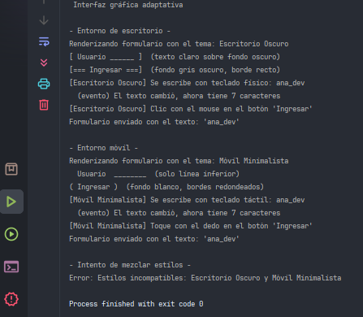

# Ejercicio 07 – Generador de elementos de interfaz gráfica adaptativa

## Descripción

Un framework de desarrollo visual debe renderizar componentes (botones y campos de texto) adaptados al sistema operativo: estilo **Escritorio Oscuro** o estilo **Minimalista Móvil**. Los componentes de una misma pantalla deben ser siempre del mismo estilo.

## Objetivos

- Implementar un Factory Method que cree familias de componentes visuales coherentes.
- Crear componentes interactivos que respondan a eventos de pulsación y de escritura.
- Impedir la mezcla de estilos en pantalla.

## Implementación del patrón Factory Method

| Rol en el patrón | Clase |
|---|---|
| Productos (interfaces) | `UiComponent` (contrato de renderizado), `Button`, `TextField` |
| Productos concretos | `DarkDesktopButton`, `DarkDesktopTextField`, `MinimalMobileButton`, `MinimalMobileTextField` |
| Creador (abstracto) | `ThemeComponentCreator` (métodos de fábrica `createButton()` y `createTextField()`) |
| Creadores concretos | `DarkDesktopCreator`, `MinimalMobileCreator` |
| Composición | `Form` |
| Cliente | `Main` |

Cada creador concreto produce únicamente componentes de su tema. `ThemeComponentCreator.buildForm()` arma un `Form`, y este verifica con `getTheme()` que el botón y el campo pertenezcan al mismo estilo; si no, lanza una excepción.

## Propósito de la clase

| Clase | Propósito |
|---|---|
| `UiComponent` | Contrato estricto: `render()` y `getTheme()`. |
| `Button` | Agrega `setOnClick()` y `click()` (evento de pulsación). |
| `TextField` | Agrega `setOnTextChanged()`, `type()` y `getText()` (evento de escritura). |
| Componentes `DarkDesktop*` | Apariencia y interacción del escritorio oscuro (mouse y teclado físico). |
| Componentes `MinimalMobile*` | Apariencia y interacción minimalista móvil (toque y teclado táctil). |
| `ThemeComponentCreator` | Declara los métodos de fábrica y arma formularios coherentes. |
| `DarkDesktopCreator` / `MinimalMobileCreator` | Producen componentes con propiedades estéticas homogéneas. |
| `Form` | Une los componentes, conecta sus eventos y valida la compatibilidad de estilos. |
| `Main` | Muestra ambos entornos y un intento de mezclar estilos. |

## Concepto clave

Cuando un creador concreto produce **todos** los componentes de un tema, la coherencia visual queda garantizada por diseño. El contrato común (`UiComponent`) permite renderizar cualquier componente sin conocer su estilo.

## Resultado

## Conclusión

Factory Method permite adaptar la interfaz a cada plataforma sin modificar el código que arma las pantallas. Para agregar un tema nuevo basta con crear sus componentes y su creador.
